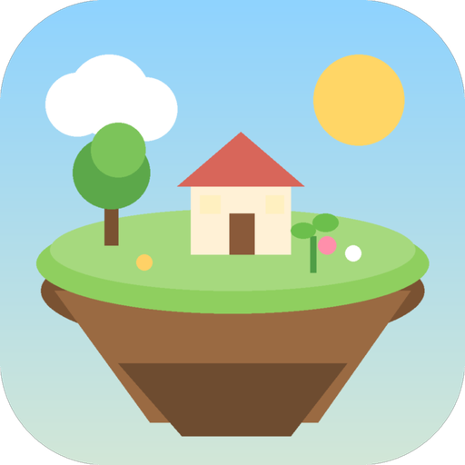

# 🌿 Mossy Meadows — Cozy Farm Adventure 2.5D

Jeu mobile cozy original : une petite vallée flottante à faire revivre. Cultiver, élever des
animaux, restaurer le village de Willowbrook, explorer 7 régions, pêcher, miner, collectionner des
créatures, décorer sa ferme et sa maison, **fonder son propre hameau avec des villageois**, parcourir les
immenses **Hautes Terres** en courant, sautant et nageant — à son rythme,
sans pression, **sans romance**.



## Télécharger / installer

Les builds Android sont dans [`builds/`](builds/) :

| Fichier | Usage |
|---|---|
| `mossy-meadows-1.6.0-debug.apk` | **APK de test 1.6.0** (Hautes Terres, nage, saut, nouveaux shaders, modèles 3D) |
| `mossy-meadows-1.5.0-release.apk` | APK release signé (1.5.0) |
| `mossy-meadows-1.5.0-release.aab` | Android App Bundle pour le Play Store (1.5.0) |

> La version **release 1.6.0** doit être signée avec votre clé d'upload (non versionnée) :
> `./android/build.sh` en local avec `android/release.jks`, ou l'action GitHub « Android release ».

Installation : copier l'APK sur le téléphone et l'ouvrir (autoriser les sources inconnues), ou
`adb install -r builds/mossy-meadows-1.6.0-debug.apk`. Android 7.0+ (API 24), WebGL 2 requis.

## Jouer dans le navigateur (développement)

```bash
cd game
npm install
npm run dev        # http://localhost:5173 (ouvrable depuis un téléphone sur le même réseau)
npm test           # tests unitaires de la logique de jeu
npm run models:check  # vérifie les modèles 3D de game/models/
npm run build      # build mono-fichier dans game/dist/index.html
```

Clavier : ZQSD/WASD/flèches pour marcher, `Maj` courir, `Espace` sauter, `E`/Entrée action, `F` outil,
`R` changer d'outil, `1-6` outils, `I` sac, `M` carte, `J` quêtes, `B` construire, `V` vue 1ʳᵉ personne,
`[` `]` tourner la caméra (ou glisser la souris), molette zoom, `Échap` menu. Sur mobile : boutons ⤴ (saut)
et 🏃 (course). On peut nager dans les lacs, rivières et la mer.

## Ajouter vos modèles 3D

Déposez des fichiers `.glb` dans **[`game/models/`](game/models/)** (directement depuis GitHub avec
*Add file → Upload files*) : `override/` remplace un modèle du jeu (arbres, rochers, meubles,
bâtiments…), `world/` + `placements.json` pose vos modèles où vous voulez. Tout est expliqué dans
[game/models/README.md](game/models/README.md). L'action GitHub « Modèles 3D » vérifie les fichiers
et construit une version jouable.

## Construire l'APK / l'AAB

```bash
./android/build.sh        # build web + APK debug + APK release + AAB release
```

Le script n'utilise ni Gradle ni Android Studio : `aapt2`, `javac`, `dx`, `zipalign`, `apksigner`
(paquets Debian/Ubuntu `aapt apksigner zipalign dalvik-exchange android-sdk-platform-23`).
La clé de release est créée au premier build dans `android/release.jks` + `android/release.properties`
(**non versionnées : sauvegardez-les**, elles sont nécessaires pour publier des mises à jour).

## Publier sur le Play Store

Voir **[store/README.md](store/README.md)** : AAB signé, textes de fiche FR/EN, visuels,
politique de confidentialité, réponses aux formulaires, et build **avec publicités AdMob** via
GitHub Actions (`.github/workflows/android-release.yml`, projet Gradle `android/gradle`).

## Documentation

- [docs/DESIGN.md](docs/DESIGN.md) — contenu et systèmes de jeu
- [docs/ARCHITECTURE.md](docs/ARCHITECTURE.md) — architecture technique, choix, performances, sauvegarde
- [docs/TESTING.md](docs/TESTING.md) — ce qui a été testé et comment
